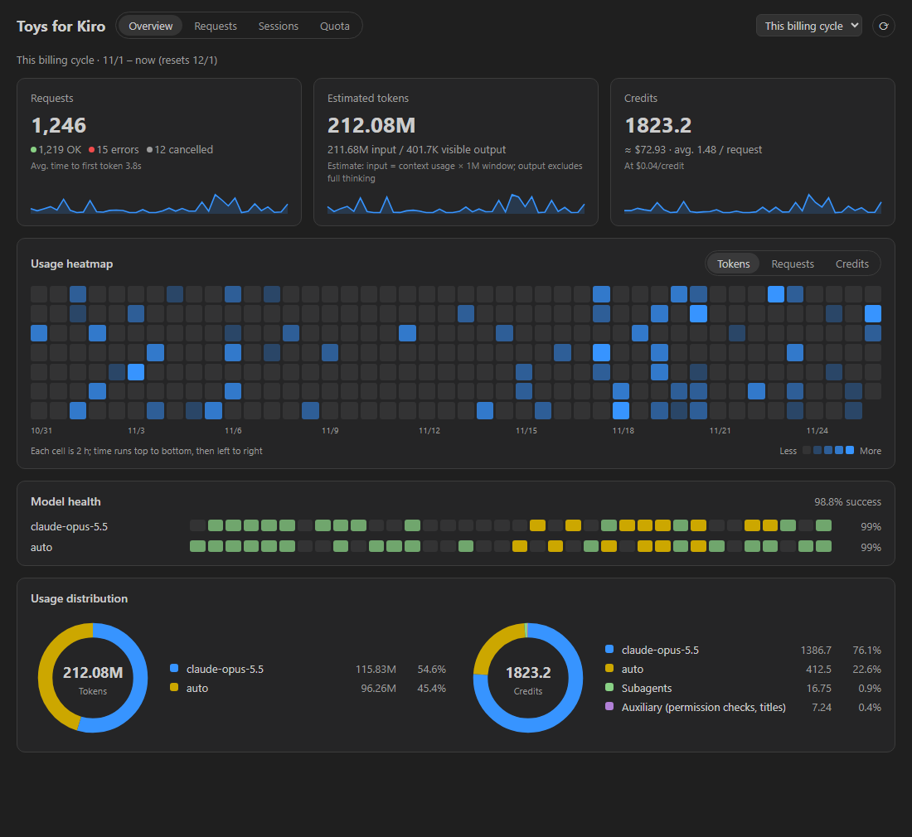
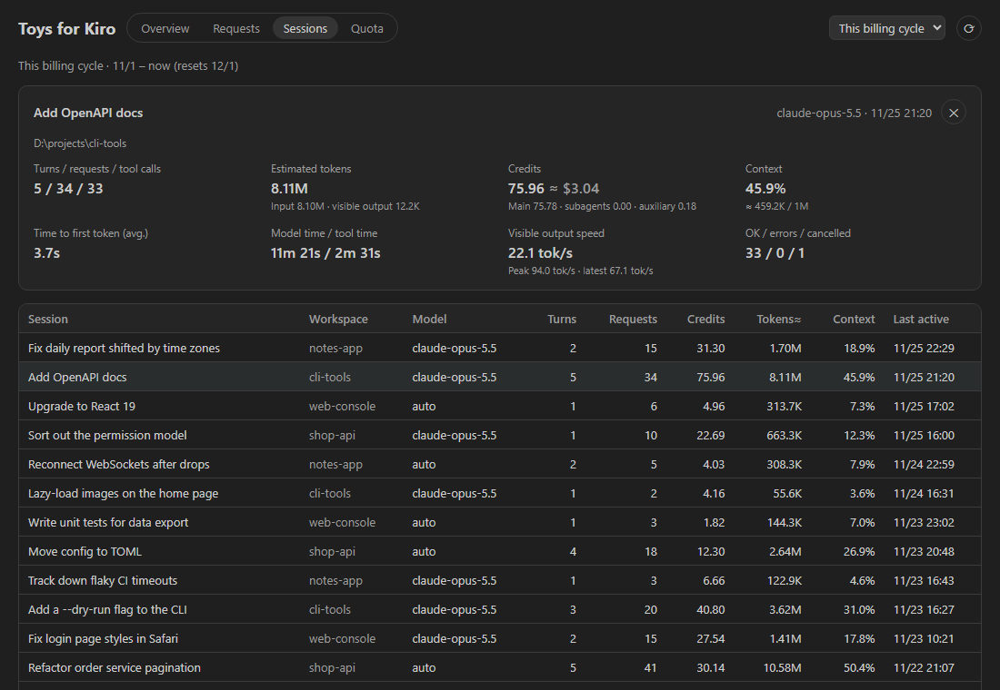
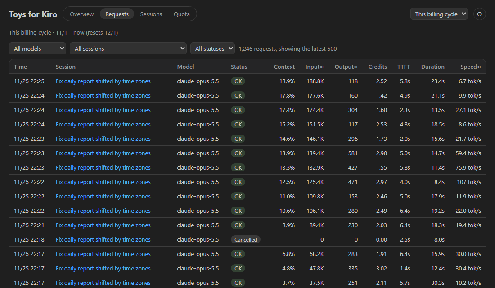

# Toys for Kiro

[](https://github.com/MOLUOGH/toys-for-kiro/releases/latest)
[](https://open-vsx.org/extension/moluogh/toys-for-kiro)
[](LICENSE)


[简体中文](https://github.com/MOLUOGH/toys-for-kiro/blob/main/README.md) | **English**

An unofficial usage dashboard for Kiro IDE. See how many credits each session used, how full its context is, and how fast each request was. It only reads Kiro's local session records and logs: it does not modify Kiro, does not go online, and uploads nothing.

> Unofficial project, not affiliated with or endorsed by AWS. Kiro is a trademark of Amazon.com, Inc. or its affiliates.
> The local file formats it reads are undocumented, so a Kiro update may require changes.

<p align="center">
  
</p>

<sub>Screenshots use made-up demo data (generated by `scripts/screenshots.ps1`).</sub>

## Features

- **Status bar**: context usage and credits of the current session. Hover for turns, requests, tool calls, credits (including subagents and auxiliary calls), estimated tokens, time to first token, model and tool time, visible output speed, and this billing cycle's quota.
- **Overview**: requests, estimated tokens, credits and their USD equivalent; a usage heatmap (cells from 5 minutes to 1 day, chosen to fit the time range); a model health timeline; usage by model.
- **Requests**: every request, filterable by model, session and status, with context usage, time to first token, duration, error type, retries and fallbacks.
- **Sessions**: a session list and full statistics for any session.
- **Quota**: plan, used and limit for this cycle, bonus credits, reset time, and daily credits on this machine.
- **Privacy switch**: keep statistics in memory only, with nothing written to disk.
- **Chinese and English UI**: follows Kiro's display language by default; can be set explicitly.
- Imports sessions in the pre-1.0 Kiro format.

<table>
  <tr>
    <td></td>
    <td></td>
  </tr>
  <tr>
    <td align="center">Session statistics</td>
    <td align="center">Request history</td>
  </tr>
</table>

## Install

Requires Kiro IDE on Windows.

**From the Extensions view (recommended)**: search for `Toys for Kiro` in Kiro's Extensions view and click Install.

**Manually**:
1. Download `toys-for-kiro-<version>.vsix` from [Releases](https://github.com/MOLUOGH/toys-for-kiro/releases/latest).
2. In Kiro, open the Command Palette (`Ctrl+Shift+P`), run `Extensions: Install from VSIX...` and pick the file.
   Or from a terminal:
   ```powershell
   & "<Kiro install dir>\bin\kiro.cmd" --install-extension toys-for-kiro-<version>.vsix
   ```

Then run `Developer: Reload Window`. A pie-chart icon appears on the right of the status bar; click it to open the dashboard.

To uninstall, remove Toys for Kiro in the Extensions view. Its index lives in `%APPDATA%\Kiro\User\globalStorage\moluogh.toys-for-kiro`; you can delete that folder afterwards.

## How accurate are the numbers

| Metric | Source | Accuracy |
|---|---|---|
| Credits | `creditSplit` in the session records (metering returned by Kiro's servers) | Close to exact. Checked against the used amount from Kiro's quota API: within about 1.6%. The gap comes from the delay between quota refreshes and local writes, and from usage not recorded on this machine |
| Context usage % | `context_usage_percentage` returned by the server | Exact |
| Input tokens | Context usage % × context window | The window size is not available locally; 1,000,000 is assumed (Kiro uses the same value when it does not know a model's window). If the window is wrong, all input tokens are off by the same factor. Can be set per model |
| Output tokens | Estimated from visible text (replies and tool-call arguments) | Low. Kiro only keeps thinking summaries, so full thinking tokens are not visible |
| Time to first token, duration, errors | Kiro log lines `q.converse.model_call_attempt` | Exact. Kiro only keeps the logs of the last ~10 launches; this extension copies them into its own index |
| USD | Credits × price | Uses the overage rate from the quota API ($0.04) by default, not your plan's actual price |
| Cache hit rate | — | Not returned by Kiro's backend, so it cannot be measured |

## Privacy and storage

- Reads local files only. No network access, no API calls, no login tokens.
- The index stores numbers and session titles only, never conversation content or account IDs.

Credits, context usage and tokens are computed from Kiro's own session files, which Kiro keeps. Only time to first token, duration and errors come from Kiro's logs, and Kiro keeps just the last ~10 launches of those.

| Mode | Writes to disk | Credits / tokens | Latency and error history |
|---|---|---|---|
| `disk` (default) | This extension's index file, a few hundred KB | Complete | Kept from the day you install it (limit with `retentionDays`) |
| `memory` | Nothing | Complete | Only the logs Kiro still keeps |

- In `memory` mode every window start rescans in the background, usually in a few seconds. When you switch from `disk` to `memory`, the extension offers to delete the saved index.
- `Toys for Kiro: Clear Local Data` deletes the index file. In `disk` mode it is rebuilt right away from Kiro's current files; records from logs Kiro has already deleted are lost for good. If another Kiro window has the file open, Windows will not allow deleting it, so the extension empties it instead.

<details>
<summary>Files it reads</summary>

| Location | Contents |
|---|---|
| `~\.kiro\sessions\*\sess_*\session.json`, `messages.jsonl` | Session metadata; credits and context usage per request; request IDs per turn |
| `%APPDATA%\Kiro\logs\*\window*\exthost\kiro.kiroAgent\Kiro Logs.log` | Duration and outcome of each model call (only these log lines are read) |
| `q-client.log` in the same folder | Responses of the quota API (account IDs are not stored) |
| `%APPDATA%\Kiro\User\globalStorage\state.vscdb` | Quota data cached by Kiro (opened read-only) |
| `%APPDATA%\Kiro\User\globalStorage\kiro.kiroagent\` | Sessions in the pre-1.0 format |

</details>

## Settings

| Setting | Default | Description |
|---|---|---|
| `toysForKiro.language` | auto | UI language: `auto` follows Kiro, `zh-CN` Chinese, `en` English |
| `toysForKiro.contextWindowTokens` | 1000000 | Context window used to turn usage percentages into tokens |
| `toysForKiro.modelContextWindows` | `{}` | Per-model context windows |
| `toysForKiro.creditPriceUsd` | 0 | USD per credit; 0 uses the overage rate |
| `toysForKiro.importLegacySessions` | true | Import and show pre-1.0 sessions |
| `toysForKiro.storage.mode` | disk | `disk` keeps the index; `memory` keeps statistics in memory only |
| `toysForKiro.storage.retentionDays` | 0 | Days to keep latency and error records; 0 keeps them forever |
| `toysForKiro.statusBar.enabled` | true | Show the status bar item |
| `toysForKiro.refreshIntervalSeconds` | 5 | Seconds between scans |
| `toysForKiro.defaultRange` | cycle | Default time range of the dashboard |

Command and setting names follow Kiro's display language. `toysForKiro.language` controls the dashboard, the status bar and dialogs.

## Limitations

- Only tested on Windows.
- The "current session" is the most recently active session in the current workspace. With several sessions open, it may not be the one you are looking at.
- Legacy sessions have no credits, and their input tokens are estimated once per run from the final context, so they read low.
- For the turn in progress, request IDs are only written when the turn ends. Until then, latency data is matched to the log by time order.

## Development

If Node.js is not installed, the scripts run Kiro's bundled Electron in Node mode:

```powershell
.\scripts\node.ps1 --test test/*.test.js        # tests
.\scripts\package.ps1                             # build the VSIX into dist\
.\scripts\screenshots.ps1                         # regenerate README screenshots from demo data
.\scripts\node.ps1 scripts\inspect.js             # index this machine's real data into a temp DB and print a summary
```

Releasing: bump the version in `package.json`, add a `CHANGELOG.md` section, commit, and push a `v<version>` tag. GitHub Actions runs the tests, packages the VSIX, creates the Release and publishes to Open VSX (needs the `OVSX_PAT` repository secret).

## License

[MIT](LICENSE)
