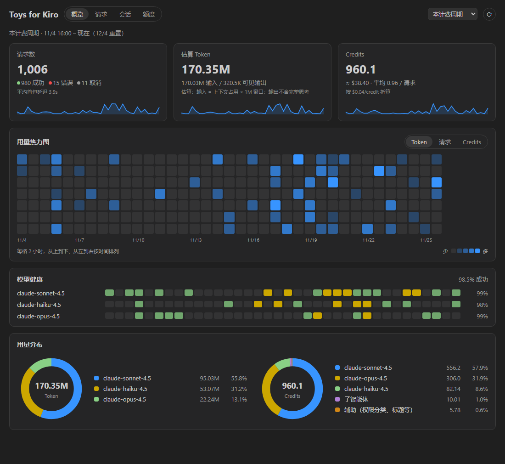
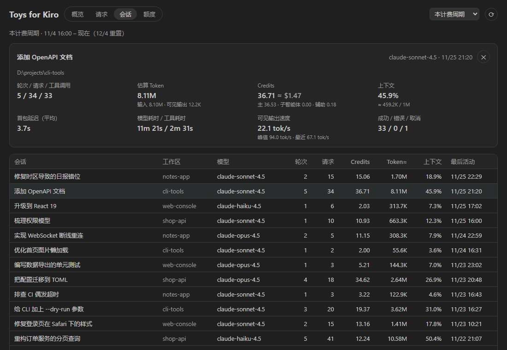
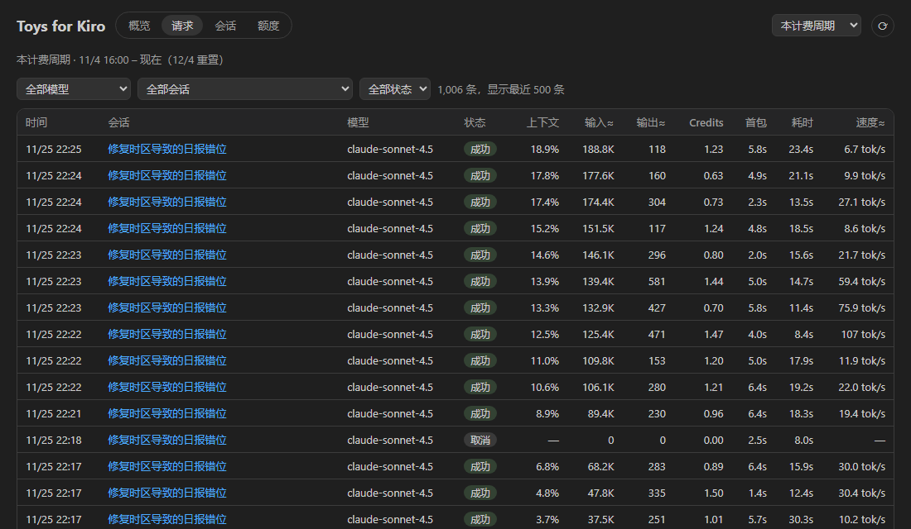

# Toys for Kiro

[](https://github.com/MOLUOGH/toys-for-kiro/releases/latest)
[](LICENSE)


Kiro IDE 的非官方用量面板：看清每个会话花了多少 credits、上下文占了多少、每次请求有多快。只读取本机的 Kiro 会话记录和日志，不修改 Kiro，不联网，不上传任何数据。

> 非官方项目，与 AWS 无关联，也未获得其认可。Kiro 是 Amazon.com, Inc. 或其关联公司的商标。
> 依赖的本地文件格式没有官方文档，Kiro 更新后可能需要适配。

<p align="center">
  
</p>

<sub>截图使用编造的演示数据（`scripts/screenshots.ps1` 生成）。</sub>

**English:** An unofficial usage dashboard for Kiro IDE. It shows credits, estimated tokens, context usage, per-request latency and your billing-cycle quota, read only from Kiro's local files. Nothing is modified or uploaded. Windows only for now; the UI is in Chinese.

## 功能

- **状态栏**：当前会话的上下文占用和已用 credits。悬停可以看到轮次、请求、工具调用、credits（含子智能体和辅助）、估算 token、首包延迟、模型和工具耗时、可见输出速度，以及本计费周期的额度。
- **概览**：请求数、估算 token、credits 和折算美元；用量热力图（每格 5 分钟到 1 天，随时间范围自动调整）；模型健康时间线；按模型的用量分布。
- **请求**：逐条请求记录，可按模型、会话、状态筛选，显示上下文占用、首包延迟、耗时、错误类型、重试和回退。
- **会话**：会话列表和单个会话的完整统计。
- **额度**：套餐、本周期已用和上限、奖励额度、重置时间、本机每日 credits。
- **隐私开关**：可以只在内存里统计，不写磁盘。
- 支持导入 Kiro 1.0 之前的旧格式会话。

<table>
  <tr>
    <td></td>
    <td></td>
  </tr>
  <tr>
    <td align="center">会话统计</td>
    <td align="center">请求记录</td>
  </tr>
</table>

## 安装

需要 Kiro IDE（Windows）。

1. 从 [Releases](https://github.com/MOLUOGH/toys-for-kiro/releases/latest) 下载 `toys-for-kiro-<版本>.vsix`。
2. 在 Kiro 里打开命令面板（`Ctrl+Shift+P`），执行 `Extensions: Install from VSIX...`，选择下载的文件。
   也可以在终端里执行：
   ```powershell
   & "<Kiro 安装目录>\bin\kiro.cmd" --install-extension toys-for-kiro-<版本>.vsix
   ```
3. 执行 `Developer: Reload Window`。状态栏右侧出现饼图图标即安装成功，点击它打开用量面板。

卸载：在扩展视图里卸载 Toys for Kiro。本扩展的索引保存在 `%APPDATA%\Kiro\User\globalStorage\moluogh.toys-for-kiro`，卸载后可以手动删除。

## 数字有多准

| 指标 | 来源 | 准确度 |
|---|---|---|
| Credits | 会话记录里的 `creditSplit`（Kiro 服务端返回的计量） | 基本精确。与 Kiro 额度接口的已用量核对，相差约 1.6%。差额来自额度刷新与本地写入的时间差，以及不在本机会话记录里的用量 |
| 上下文占用 % | 服务端返回的 `context_usage_percentage` | 精确 |
| 输入 token | 上下文占用 % × 上下文窗口 | 窗口大小本地拿不到，默认按 1,000,000 计算（Kiro 在不知道模型窗口时也用这个值）。窗口不对时，所有输入 token 按比例偏差。可在设置里按模型修改 |
| 输出 token | 可见文本（回复 + 工具调用参数）按字符估算 | 偏低。Kiro 只保存思考摘要，完整思考 token 看不到 |
| 首包延迟、耗时、错误 | Kiro 日志 `q.converse.model_call_attempt` | 精确。Kiro 只保留最近约 10 次启动的日志，本扩展会把它们存进自己的索引 |
| 美元 | credits × 单价 | 默认用额度接口返回的超额单价（$0.04），不是你套餐的实际单价 |
| 缓存命中率 | — | Kiro 后端不返回，无法统计 |

## 隐私和数据保存

- 只读取本机文件，不联网，不调用任何接口，不读取登录令牌。
- 索引里只保存数字和会话标题，不保存对话内容和账号 ID。

Credits、上下文占用和 token 都从 Kiro 自己的会话文件计算，Kiro 会一直保留这些文件。只有首包延迟、耗时和错误来自 Kiro 的日志，而 Kiro 只保留最近约 10 次启动的日志。

| 模式 | 写入磁盘 | Credits / token | 延迟和错误的历史 |
|---|---|---|---|
| `disk`（默认） | 本扩展的索引文件，约几百 KB | 完整 | 从安装本扩展起一直保留（可用 `retentionDays` 限制） |
| `memory` | 不写入 | 完整 | 只有 Kiro 现存的日志 |

- `memory` 模式每次打开窗口都会在后台重新扫描一遍，通常几秒。从 `disk` 切到 `memory` 时，扩展会询问是否删除已保存的索引。
- 命令 `Toys for Kiro: 清除本地数据` 删除索引文件。`disk` 模式下会立刻从 Kiro 现有文件重新生成，Kiro 已删除的日志里的记录会永久丢失。如果另一个 Kiro 窗口正在使用这个文件，Windows 不允许删除，扩展会改为清空文件内容。

<details>
<summary>读取的文件</summary>

| 位置 | 内容 |
|---|---|
| `~\.kiro\sessions\*\sess_*\session.json`、`messages.jsonl` | 会话元数据；每次请求的 credits 和上下文占用、每轮的请求 ID |
| `%APPDATA%\Kiro\logs\*\window*\exthost\kiro.kiroAgent\Kiro Logs.log` | 每次模型调用的耗时和结果（只读取这一类日志行） |
| 同目录 `q-client.log` | 额度接口的返回值（不保存账号 ID） |
| `%APPDATA%\Kiro\User\globalStorage\state.vscdb` | Kiro 缓存的额度信息（只读打开） |
| `%APPDATA%\Kiro\User\globalStorage\kiro.kiroagent\` | 1.0 之前的旧格式会话 |

</details>

## 设置

| 设置 | 默认值 | 说明 |
|---|---|---|
| `toysForKiro.contextWindowTokens` | 1000000 | 上下文窗口大小，用于把占用百分比换算成 token |
| `toysForKiro.modelContextWindows` | `{}` | 按模型覆盖窗口大小 |
| `toysForKiro.creditPriceUsd` | 0 | 每 credit 的美元价格，0 表示用超额单价 |
| `toysForKiro.importLegacySessions` | true | 导入并显示 1.0 之前的旧格式会话 |
| `toysForKiro.storage.mode` | disk | `disk` 保存索引；`memory` 只在内存里统计，不写入磁盘 |
| `toysForKiro.storage.retentionDays` | 0 | 延迟和错误记录保留天数，0 表示永久 |
| `toysForKiro.statusBar.enabled` | true | 显示状态栏项 |
| `toysForKiro.refreshIntervalSeconds` | 5 | 扫描间隔（秒） |
| `toysForKiro.defaultRange` | cycle | 面板默认时间范围 |

## 限制

- 只在 Windows 上测试过。
- "当前会话"取当前工作区里最近有活动的会话。同时开着多个会话时，可能不是你正在看的那个。
- 旧版会话没有 credits；每次执行只按最终上下文估算一次输入 token，数值偏低。
- 正在进行的那一轮，请求 ID 要等这一轮结束才写入。在此之前，延迟数据按时间顺序和日志配对。

## 开发

本机没有 Node 时，脚本会用 Kiro 自带的 Electron 以 Node 模式运行：

```powershell
.\scripts\node.ps1 --test test/*.test.js        # 测试
.\scripts\package.ps1                             # 打包 VSIX 到 dist\
.\scripts\screenshots.ps1                         # 用演示数据重新生成 README 截图
.\scripts\node.ps1 scripts\inspect.js             # 用本机真实数据建临时索引并打印摘要
```

发版：更新 `package.json` 的版本号和 `CHANGELOG.md`，提交后推送 `v<版本>` 标签。GitHub Actions 会跑测试、打包并创建 Release。

## 许可证

[MIT](LICENSE)
